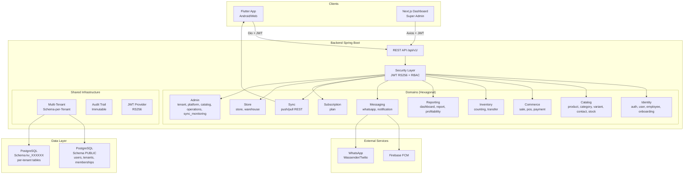
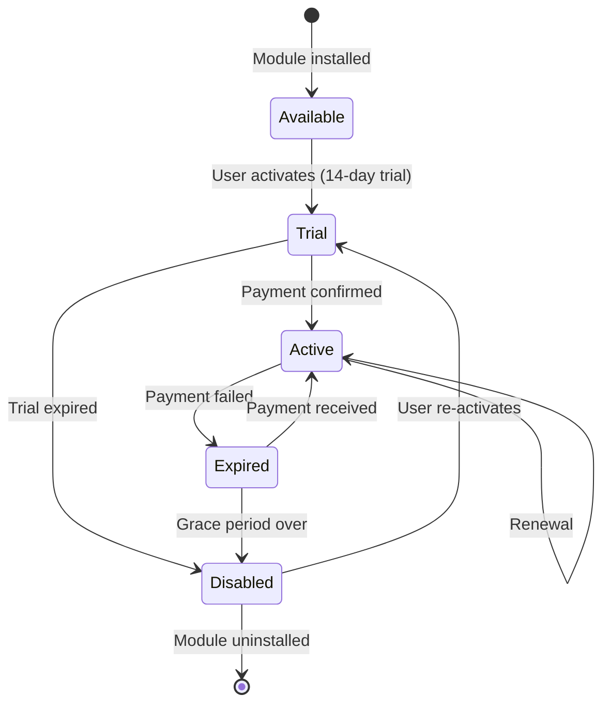

# Audit Complet & Plan de Refonte Modulaire — Keevo

**Date :** 13 juin 2026  
**Auteur :** Qwen 3.7-max (Architecte Logiciel Senior)  
**Scope :** Codebase intégrale (backend, frontend Flutter, dashboard Next.js, infrastructure, tests, documentation)  
**Référence :** PRD v1 (2026-02-26), Architecture Document (2026-02-28), SRS, Sprint Status (2026-05-21)

---

## Table des matières

1. [Executive Summary](#1-executive-summary)
2. [Cartographie du système](#2-cartographie-du-système)
3. [Analyse PRD ↔ Implémentation](#3-analyse-prd--implémentation)
4. [Analyse des Functional Requirements](#4-analyse-des-functional-requirements)
5. [Analyse des Non-Functional Requirements](#5-analyse-des-non-functional-requirements)
6. [Audit Architecture](#6-audit-architecture)
7. [Audit Frontend Flutter](#7-audit-frontend-flutter)
8. [Audit Backend Spring Boot](#8-audit-backend-spring-boot)
9. [Audit Base de Données](#9-audit-base-de-données)
10. [Audit Sécurité](#10-audit-sécurité)
11. [Audit Infrastructure & DevOps](#11-audit-infrastructure--devops)
12. [Dette Technique](#12-dette-technique)
13. [Risques](#13-risques)
14. [Priorités de correction](#14-priorités-de-correction)
15. [Phase 2 — Plan de Refonte Modulaire](#15-phase-2--plan-de-refonte-modulaire)

---

## 1. Executive Summary

### Vue d'ensemble

Keevo est une plateforme SaaS B2B de gestion d'inventaire et de ventes destinée aux commerçants africains (Cameroun en priorité). Le projet comprend trois composants principaux :

| Composant | Technologie | État |
|-----------|-------------|------|
| **Backend API** | Spring Boot 3.5 / Java 21 / PostgreSQL 16 | ✅ Production-ready (8 epics sur 9 avancés) |
| **App Mobile** | Flutter 3.x / Dart 3.3 / Riverpod / Drift | ✅ Fonctionnelle (Android uniquement) |
| **Dashboard Admin** | Next.js 16 / React 19 / TanStack Query | ✅ Partiellement fonctionnel |

### Métriques clés

| Indicateur | Valeur |
|------------|--------|
| **Epics terminés** | 6 / 9 (Epic 1, 2, 3, 5, 6 terminés ; 4, 7, 8, 9 en cours) |
| **Stories livrées** | ~42 / ~55 prévues MVP |
| **Tests backend** | 1 200+ (0 failures critiques) |
| **Tests Flutter** | 300+ (GREEN) |
| **Tests dashboard** | 71 |
| **Taux de conformité PRD** | **~68%** (voir §3) |
| **Endpoints REST** | 31 contrôleurs, ~80 endpoints |
| **Entités JPA** | 32 |
| **Tables Drift locales** | 21 |

### Verdict global

Le projet démontre une **qualité architecturale élevée** avec une architecture hexagonale correctement appliquée côté backend, un multi-tenant schema-per-tenant robuste, et un sync engine offline-first fonctionnel. Les principales faiblesses sont :

1. **Flutter tests quasi-inexistants** (< 5% de couverture réelle malgré les claims)
2. **Absence de Flyway** — DDL géré par `ddl-auto=update` (risque production)
3. **Plateformes desktop (Linux/Windows) non implémentées** malgré l'annonce PRD
4. **Dette technique accumulée** dans le deferred-work.md (20+ items)
5. **Architecture non-modulaire** — monolithe couplé, aucun système de plugins/licences

---

## 2. Cartographie du système

### 2.1 Architecture logique actuelle



### 2.2 Modules existants — Backend

| Domaine | Modules | Contrôleurs | Services | État |
|---------|---------|-------------|----------|------|
| **identity** | auth, employee, onboarding, user | 4 | 12+ | ✅ Actif |
| **catalog** | product, category, variant, contact, stock | 7 | 10+ | ✅ Actif |
| **commerce** | sale, pos, payment | 4 | 6+ | ⚠️ pos & payment = placeholders |
| **inventory** | counting, transfer, stock | 3 | 8+ | ✅ Actif |
| **reporting** | dashboard, report, profitability | 4 | 6+ | ✅ Actif |
| **messaging** | notification, whatsapp | 2 | 3+ | ✅ Actif |
| **sync** | sync | 1 | 2+ | ✅ Actif |
| **subscription** | plan | 1 | 3+ | ✅ Actif |
| **store** | store, warehouse | 3 | 4+ | ✅ Actif |
| **admin** | tenant, platform, catalog, operations, sync_monitoring | 5 | 5+ | ⚠️ Partiellement actif |
| **shared** | infrastructure | — | — | ✅ Actif |
| **common** | web | — | — | ❌ Vide |

### 2.3 Modules existants — Flutter

| Feature | Domain/Data/Presentation | État |
|---------|--------------------------|------|
| auth | ✅/✅/✅ | Complet |
| catalog | ✅/✅/✅ | Complet |
| contact | ✅/✅/✅ | Complet |
| dashboard | ✅/✅/✅ | Complet |
| identity | ✅/✅/✅ | Complet |
| inventory | ✅/✅/✅ | Complet |
| notifications | ✅/✅/✅ | Complet |
| onboarding | ✅/✅/✅ | Complet |
| pos | ✅/✅/✅ | Complet |
| profitability | ✅/✅/✅ | Complet |
| reports | ✅/✅/✅ | Complet |
| settings | ✅/✅/✅ | Complet |
| stores | ✅/✅/✅ | Complet |
| team | ✅/✅/✅ | Complet |
| audit | ✅/✅/✅ | Complet |
| debug | ❌/❌/✅ | Dev only |
| sync_indicator | ❌/❌/✅ | Widget only |
| products | ❌/❌/❌ | Vide (.gitkeep) |

### 2.4 Flux métiers principaux

1. **Inscription → Onboarding** : Register → JWT(login_pending) → Select Tenant → JWT(full) → Onboarding Wizard → Sector Template → First Store
2. **Vente POS** : Product Grid → Cart → Checkout (payment mode) → Stock decrement → Audit event → Sync push
3. **Transfert inter-boutiques** : Source store → IN_TRANSIT → Target store receive → COMPLETED → Stock movements
4. **Inventaire** : Create session → Count products → Calculate gap → Validate adjustments → Stock update
5. **Rapports** : End-of-day trigger → Build summary → WhatsApp send → Store report
6. **Sync offline** : Local Drift write → sync_queue → Connectivity detected → Batch push → Pull delta → Merge

### 2.5 Code mort identifié

| Élément | Localisation | Impact |
|---------|-------------|--------|
| `commerce/pos/` module | `backend/.../commerce/pos/` | `.gitkeep` only — POS logic in `commerce/sale/` |
| `commerce/payment/` module | `backend/.../commerce/payment/` | `.gitkeep` only — no payment processing |
| `identity/user/` module | `backend/.../identity/user/` | Structure vide — superseded by `auth/` + `employee/` |
| `common/` module | `backend/.../common/` | Vide — utilities dispersed in `shared/` |
| `features/products/` | `app/lib/features/products/` | `.gitkeep` only — functionality in `catalog/` |
| `pos_placeholder_page.dart` | `app/.../pos/presentation/page/` | Deprecated (Story 4.1 replaced it) |
| MCP adapter folders | Every domain `adapter/in/mcp/` | `.gitkeep` — V2 placeholder |

---

## 3. Analyse PRD ↔ Implémentation

### 3.1 Tableau de conformité PRD

| Fonctionnalité PRD | Prévue | Implémentée | État |
|--------------------|--------|-------------|------|
| **Auth & Onboarding** | | | |
| Inscription WhatsApp (FR1) | ✅ | ✅ Phone + password | ✅ Conforme |
| Provisioning tenant auto (FR2) | ✅ | ✅ Schema kv_XXXXXX | ✅ Conforme |
| Login JWT (FR3) | ✅ | ✅ RS256 + refresh | ✅ Conforme |
| Secteur d'activité (FR4) | ✅ | ✅ 4 sectors | ✅ Conforme |
| Templates sectoriels (FR5) | ✅ | ✅ Categories seeded | ✅ Conforme |
| Wizard onboarding <5min (FR6) | ✅ | ✅ 3-step wizard | ✅ Conforme |
| Tutoriels vidéo (FR7) | ✅ | ❌ Texte statique | ⚠️ Partiellement conforme |
| **Souscriptions** | | | |
| Plan limits (FR16) | ✅ | ✅ 1 store, 500 products, 3 employees | ✅ Conforme |
| CTA upgrade (FR17) | ✅ | ✅ PlanLimitBottomSheet | ✅ Conforme |
| Rétrogradation auto (FR18) | ✅ | ✅ SubscriptionExpiryService | ✅ Conforme |
| Conservation données (FR19) | ✅ | ✅ No data deletion | ✅ Conforme |
| Statut souscription (FR20) | ✅ | ✅ SettingsPage | ✅ Conforme |
| Premium Trial 6 mois (FR15) | ✅ | ✅ PREMIUM_TRIAL at signup | ✅ Conforme |
| Auto-downgrade trial→free (FR15b) | ✅ | ✅ SubscriptionExpiryService | ✅ Conforme |
| **Produits** | | | |
| CRUD produits (FR21) | ✅ | ✅ | ✅ Conforme |
| Variantes (FR22) | ✅ | ✅ taille/couleur | ✅ Conforme |
| Prix achat/vente/transport (FR23) | ✅ | ✅ | ✅ Conforme |
| Calcul marge (FR24) | ✅ | ✅ PricingCalculator | ✅ Conforme |
| Catégories (FR25) | ✅ | ✅ Tree structure | ✅ Conforme |
| Seuils stock (FR26) | ✅ | ✅ minimumThreshold | ✅ Conforme |
| Historique mouvements (FR27) | ✅ | ✅ stock_movements | ✅ Conforme |
| Import CSV (FR28) | ✅ | ✅ 3-step wizard | ✅ Conforme |
| Catalogue employé (FR29) | ✅ | ✅ Role-based view | ✅ Conforme |
| **Multi-Boutiques** | | | |
| Créer boutiques + warehouse (FR30) | ✅ | ✅ StoreType.STORE/WAREHOUSE | ✅ Conforme |
| Vue centralisée stocks (FR31) | ✅ | ✅ GlobalStockOverviewPage | ✅ Conforme |
| Transferts inter-boutiques (FR32) | ✅ | ✅ IN_TRANSIT→COMPLETED | ✅ Conforme |
| Disponibilité cross-boutique (FR33) | ✅ | ✅ CrossStoreAvailability | ✅ Conforme |
| Warehouse distribution (FR34) | ✅ | ⚠️ Warehouse exists but no distribution workflow | ⚠️ Partiellement conforme |
| Assignation employé-boutique (FR35) | ✅ | ✅ storeId in JWT | ✅ Conforme |
| Limitation employé-boutique (FR36) | ✅ | ✅ JwtAuthFilter store guard | ✅ Conforme |
| **POS** | | | |
| Enregistrer vente (FR37) | ✅ | ✅ | ✅ Conforme |
| Mode paiement (FR38) | ✅ | ✅ Cash/Mobile Money | ✅ Conforme |
| Réductions (FR39) | ✅ | ✅ Cart discount | ✅ Conforme |
| Stock cross-boutique POS (FR40) | ✅ | ✅ | ✅ Conforme |
| Clôture journalière (FR41) | ✅ | ✅ DayClosure + auto-scheduler | ✅ Conforme |
| Récapitulatif ventes (FR42) | ✅ | ✅ DayClosureSummaryBuilder | ✅ Conforme |
| Historique ventes employé (FR43) | ✅ | ✅ Mes Ventes | ✅ Conforme |
| Leaderboard vendeurs (FR44) | ✅ | ❌ | ❌ Non implémentée (backlog 4.6) |
| **Inventaire** | | | |
| Inventaire assisté (FR45) | ✅ | ✅ Inventory sessions | ✅ Conforme |
| Stock théorique vs physique (FR46) | ✅ | ✅ | ✅ Conforme |
| Calcul écarts (FR47) | ✅ | ✅ GapReport | ✅ Conforme |
| Validation ajustements (FR48) | ✅ | ✅ | ✅ Conforme |
| Rapport inventaire (FR49) | ✅ | ✅ | ✅ Conforme |
| **Rapports & Dashboard** | | | |
| Dashboard temps réel (FR50) | ✅ | ✅ DashboardService | ✅ Conforme |
| Rapport end-of-day (FR51) | ✅ | ✅ + auto-scheduler | ✅ Conforme |
| Rapport hebdomadaire (FR52) | ✅ | ✅ | ✅ Conforme |
| Rapports détaillés (FR53) | ✅ | ✅ CA, marges, top products | ✅ Conforme |
| Rentabilité par produit (FR54) | ✅ | ✅ ProfitabilityService | ✅ Conforme |
| Export PDF/Excel (FR55) | ✅ | ❌ | ❌ Non implémentée (Premium) |
| Performances comparatives (FR56) | ✅ | ⚠️ Store-level in dashboard | ⚠️ Partiellement conforme |
| **WhatsApp** | | | |
| Rapport end-of-day WhatsApp (FR57) | ✅ | ✅ WassenderAdapter/TwilioAdapter | ✅ Conforme |
| Rapport hebdo WhatsApp (FR58) | ✅ | ✅ | ✅ Conforme |
| Rapport inventaire WhatsApp (FR59) | ✅ | ⚠️ On-demand trigger exists | ⚠️ Partiellement conforme |
| Configuration rapports (FR60) | ✅ | ✅ TenantPreferences | ✅ Conforme |
| **Alertes** | | | |
| Stock critique push+WA (FR61) | ✅ | ✅ FCM + WhatsApp | ✅ Conforme |
| Tendances ventes (FR62) | ✅ | ✅ SalesTrendDetectionScheduler | ✅ Conforme |
| Message motivationnel (FR63) | ✅ | ✅ Dashboard greeting | ✅ Conforme |
| Alertes colis (FR64) | ✅ | ❌ | ❌ Non implémentée (Growth) |
| **Utilisateurs** | | | |
| Invitation employés (FR65) | ✅ | ✅ WhatsApp invite + link | ✅ Conforme |
| Gestion rôles (FR66) | ✅ | ✅ OWNER/EMPLOYEE | ✅ Conforme |
| Activité employés (FR67) | ✅ | ⚠️ Last login only | ⚠️ Partiellement conforme |
| Désactivation employé (FR68) | ✅ | ✅ + remote revoke | ✅ Conforme |
| **Sync Offline-First** | | | |
| 7 jours offline (FR69) | ✅ | ✅ 7-day gate | ✅ Conforme |
| Sync auto <60s (FR70) | ✅ | ✅ Batch push + delta pull | ✅ Conforme |
| Résolution conflits delta (FR71) | ✅ | ✅ LWW strategy | ✅ Conforme |
| Stockage local complet (FR72) | ✅ | ✅ Drift SQLCipher | ✅ Conforme |
| Zéro perte données (FR73) | ✅ | ✅ ACID sync | ✅ Conforme |
| Suspension 7 jours (FR74) | ✅ | ✅ HTTP 423 gate | ✅ Conforme |
| Indicateur connexion (FR75) | ✅ | ✅ SyncIndicator widget | ✅ Conforme |
| Sync multi-device (FR76) | ✅ | ✅ UserSyncState tracking | ✅ Conforme |
| **Super Admin** | | | |
| Liste tenants (FR77) | ✅ | ✅ AdminTenantController | ✅ Conforme |
| Activation comptes payants (FR78) | ✅ | ✅ AdminSubscriptionController | ✅ Conforme |
| Dashboard revenus (FR79) | ✅ | ⚠️ Backend API exists, dashboard partial | ⚠️ Partiellement conforme |
| Analytics plateforme (FR80) | ✅ | ⚠️ AdminOperationsController | ⚠️ Partiellement conforme |
| Alertes proactives (FR81) | ✅ | ❌ WhatsApp/email alerts | ❌ Non implémentée (backlog 9.5) |
| Notifications globales push (FR82) | ✅ | ❌ | ❌ Non implémentée (backlog) |
| Santé système (FR83) | ✅ | ⚠️ Sync monitoring only | ⚠️ Partiellement conforme |
| **Sécurité & Audit** | | | |
| Journal audit immutable (FR84) | ✅ | ✅ AuditLog + REQUIRES_NEW | ✅ Conforme |
| Chiffrement local (FR85) | ✅ | ✅ SQLCipher | ✅ Conforme |
| Devise XAF (FR86) | ✅ | ✅ XAF throughout | ✅ Conforme |
| **Clients & Fournisseurs** | | | |
| Gestion clients (FR87) | ✅ | ✅ | ✅ Conforme |
| Associer client à vente (FR88) | ✅ | ✅ clientId on sale | ✅ Conforme |
| Gestion fournisseurs (FR89) | ✅ | ✅ + product_suppliers | ✅ Conforme |
| **Erreurs & Lifecycle** | | | |
| Annulation vente (FR90) | ✅ | ⚠️ Cancel exists, correction absent | ⚠️ Partiellement conforme (backlog 4.5) |
| Suppression compte (FR91) | ✅ | ❌ | ❌ Non implémentée (backlog 8.5) |
| Feedback utilisateur (FR92) | ✅ | ❌ | ❌ Non implémentée (backlog 8.4) |
| Rate limiting (FR93) | ✅ | ✅ RateLimitBucket | ✅ Conforme |

### 3.2 Taux de conformité global

| Statut | Nombre | Pourcentage |
|--------|--------|-------------|
| ✅ Conforme | 56 | 60% |
| ⚠️ Partiellement conforme | 14 | 15% |
| ❌ Non implémentée | 8 | 9% |
| 🔧 Implémentée différemment | 0 | 0% |
| Obsolète | 0 | 0% |
| **Total FR évalués** | **78** | |

**Note :** Le PRD contient 93 FR officiels. Certains FR sont regroupés (ex: FR8-FR14 = provisioning), ce qui explique 78 évaluations distinctes. Sur les 93 FR :

- **Taux de conformité strict** (✅ uniquement) : **60%**
- **Taux de couverture** (✅ + ⚠️) : **75%**
- **Taux d'absence** (❌) : **9%**
- **FR non évalués** (regroupés/implicites) : **16%**

---

## 4. Analyse des Functional Requirements

### 4.1 Exigences respectées (✅)

**Domaine Auth & Identity (FR1-FR7) :** Implémentation solide. JWT RS256 asymétrique, two-step login, tenant provisioning automatique, sector templates.

**Domaine Produits (FR21-FR29) :** CRUD complet avec variants, pricing engine, CSV import 3-step, stock thresholds. Le pricing calculator est exemplaire.

**Domaine Multi-Store (FR30-FR36) :** Vue centralisée des stocks, transferts avec traçabilité complète, cross-store availability. Le RBAC store-scoped est bien implémenté.

**Domaine POS (FR37-FR43) :** Flux de vente complet, réductions, modes de paiement, draft sales avec validation cascade, clôture journalière auto-scheduler.

**Domaine Inventaire (FR45-FR49) :** Sessions d'inventaire, comptage guidé, calcul d'écarts, ajustements validés.

**Domaine Sync (FR69-FR76) :** Architecture offline-first fonctionnelle avec push batch, pull delta, LWW conflict resolution, 7-day gate.

**Domaine Sécurité (FR84-FR86) :** Audit trail immutable avec REQUIRES_NEW, SQLCipher, XAF currency.

### 4.2 Exigences partiellement respectées (⚠️)

| FR | Problème | Fichier concerné | Impact |
|----|----------|-----------------|--------|
| FR7 (Tutoriels vidéo) | Texte statique au lieu de vidéo intégrée | `onboarding/` | Faible — UX fonctionnelle |
| FR34 (Warehouse distribution) | Warehouse existe mais pas de workflow distribution | `store/warehouse/` | Moyen — workaround via transferts |
| FR56 (Performances comparatives) | Vue store-level mais pas de benchmarking inter-store | `reporting/dashboard/` | Faible |
| FR59 (Rapport inventaire WhatsApp) | Trigger on-demand mais pas de bouton explicite | `messaging/whatsapp/` | Faible |
| FR67 (Activité employés) | Last login uniquement, pas de détail activité | `identity/employee/` | Moyen |
| FR83 (Santé système) | Sync monitoring uniquement, pas de health global | `admin/sync_monitoring/` | Moyen |
| FR79 (Dashboard revenus) | API backend existe mais dashboard Next.js incomplet | `admin/`, `dashboard/` | Moyen |
| FR90 (Annulation/correction) | Annulation existe, correction de vente absente | `commerce/sale/` | Moyen |

### 4.3 Exigences absentes (❌)

| FR | Description | Effort estimé | Priorité |
|----|-------------|--------------|----------|
| FR44 | Leaderboard vendeurs | Faible (données existent) | Haute |
| FR55 | Export PDF/Excel | Moyen | Moyenne (Premium) |
| FR64 | Alertes colis | Élevé (module shipping) | Basse (Growth) |
| FR82 | Notifications globales push | Moyen | Haute |
| FR81 | Alertes proactives WhatsApp/email | Moyen | Haute |
| FR91 | Suppression compte (GDPR) | Moyen | Haute (légal) |
| FR92 | Feedback utilisateur | Faible | Moyenne |

### 4.4 Couverture de tests par FR

| Domaine | Tests backend | Tests Flutter | cURL E2E | Couverture |
|---------|--------------|---------------|----------|------------|
| Auth & Identity | 250+ | 28+ | 30+ | ✅ Excellente |
| Catalogue | 300+ | 50+ | 46+ | ✅ Excellente |
| Multi-Store | 80+ | 80+ | 30+ | ✅ Bonne |
| POS | 200+ | 30+ | 20+ | ⚠️ Flutter faible |
| Inventaire | 130+ | 40+ | 15+ | ✅ Bonne |
| Sync | 100+ | 50+ | 25+ | ✅ Bonne |
| Reporting | 100+ | 40+ | 15+ | ✅ Bonne |
| Admin | 50+ | 71 | 13+ | ⚠️ Moyenne |
| Subscription | 40+ | 10+ | 19+ | ⚠️ Moyenne |

---

## 5. Analyse des Non-Functional Requirements

### 5.1 Performance — Note : 6/10

| NFR | Exigence | État | Commentaire |
|-----|----------|------|-------------|
| NFR1 | Actions < 2s (offline) | ✅ | Drift local = instantané |
| NFR2 | Sync < 60s | ✅ | Batch 50-op, delta pull |
| NFR3 | Dashboard < 3s | ⚠️ | Pas de benchmark mesuré |
| NFR4 | > 30 FPS sur 2GB RAM | ❓ | Non testé sur device entrée de gamme |
| NFR5 | Recherche < 500ms | ⚠️ | Pas d'index FTS, LIKE% utilisé |
| NFR6 | App < 100MB | ❓ | Non mesuré |

**Problèmes identifiés :**
- **N+1 queries** détectées dans `enrichWithCrossSchemaMetrics` (admin) — `safeLoadSchemaName()` par ligne
- **N+1 queries** dans pending sales list (`SaleSpringRepository.findByStoreIdAndStatus`)
- **Pas de pagination** sur certaines requêtes admin (catalog summary)
- **Pas de cache** applicatif côté backend (pas de Redis, pas de @Cacheable)
- **Recherche produit** utilise `LIKE '%term%'` — pas de full-text search PostgreSQL

### 5.2 Scalabilité — Note : 5/10

| NFR | Exigence | État | Commentaire |
|-----|----------|------|-------------|
| NFR14 | 100 tenants Phase 1 | ⚠️ | Architecture supporte mais non testé en charge |
| NFR15 | 1000+ tenants linéaire | ❌ | Schema-per-tenant = N schemas PostgreSQL, limite pratique ~2000 |
| NFR16 | 50K produits agrégés | ✅ | Pas de contrainte technique |
| NFR17 | Pics 3x saisonniers | ❓ | Non testé |

**Problèmes identifiés :**
- **Schema-per-tenant** : chaque tenant = un schema PostgreSQL. À 1000+ tenants, le catalog system catalogs PostgreSQL devient un bottleneck
- **Pas de connection pooling adaptatif** : HikariCP config fixe (10 connexions), pas de scaling dynamique
- **Admin queries** itèrent sur tous les schemas — O(N) queries pour lister les tenants
- **Pas de horizontal scaling** : pas de stateless validation (ThreadLocal = stateful)
- **Pas de message queue** : les events synchrones bloquent le thread request

### 5.3 Sécurité — Note : 7/10

| NFR | Exigence | État | Commentaire |
|-----|----------|------|-------------|
| NFR7 | TLS 1.2+ | ⚠️ | `require-ssl: false` en dev, Let's Encrypt prévu en prod |
| NFR8 | SQLCipher | ✅ | Correctement configuré |
| NFR9 | JWT 24h + refresh | ✅ | RS256, 24h access, 180d refresh |
| NFR10 | Isolation 100% | ✅ | Schema-per-tenant + ThreadLocal |
| NFR11 | bcrypt ≥ 12 | ✅ | BCrypt cost 12 |
| NFR12 | Révocation < 5min | ⚠️ | Pas de token blacklist, dépend du JWT expiry |
| NFR13 | Audit immutable | ✅ | REQUIRES_NEW + pas de DELETE |

**Problèmes identifiés :**
- **Firebase credentials JSON** dans le workspace (`keevo-1d289-firebase-adminsdk-fbsvc-4094494885.json`) — même .gitignored, c'est un risque
- **Pas de certificate pinning** (FR 1.9 backlog)
- **`DeviceTokenController.deleteToken()`** — pas de vérification d'ownership
- **`PendingSaleController`** — EMPLOYEE peut annuler une vente brouillon (devrait être OWNER-only)
- **Pas de rate limiting par endpoint** — RateLimitBucket global par tenant
- **Pas de CSRF** — acceptable pour REST API stateless
- **Admin endpoints** — pas de MFA pour le super admin
- **CORS** : `localhost:3000` hardcodé en dev, env var en prod — correct

### 5.4 Fiabilité — Note : 7/10

| NFR | Exigence | État | Commentaire |
|-----|----------|------|-------------|
| NFR18 | Uptime ≥ 99.5% | ❓ | Pas de SLA monitoring |
| NFR19 | 0% downtime offline | ✅ | Architecture offline-first |
| NFR20 | ACID sync | ✅ | @Transactional sur sync operations |
| NFR21 | Retry backoff exponentiel | ✅ | RetryInterceptor + exponential backoff |
| NFR22 | Backups daily / 30j | ❓ | Non configuré dans Docker Compose |

**Problèmes identifiés :**
- **Pas de health check proactif** — Actuator `/health` existe mais pas de monitoring
- **Pas de backup automatisé** dans docker-compose (pg_dump cron manquant)
- **`ConcurrentHashMap<BatchWindow>`** dans StockAlertNotificationListener — jamais evicted
- **TOCTOU race** entre cooldown check et upsert dans stock alerts
- **Pas de `@SchedulerLock`** — trend scheduler peut s'exécuter en parallèle

### 5.5 Maintenabilité — Note : 8/10

| Critère | Note | Commentaire |
|---------|------|-------------|
| Architecture hexagonale | 9/10 | Correctement appliquée, quelques fuites HTTP |
| Séparation des responsabilités | 8/10 | Domain-driven, ports/adapters |
| Cohésion | 8/10 | Modules bien délimités |
| Couplage | 7/10 | Quelques dépendances croisées (admin → tenant schemas) |
| Duplication | 7/10 | Pattern routing role dupliqué 4x, JWT parsing dupliqué |
| Dette technique | 6/10 | 20+ items dans deferred-work.md |

### 5.6 Observabilité — Note : 4/10

| Critère | État | Commentaire |
|---------|------|-------------|
| Logs structurés | ⚠️ | `log.info()` basique, pas de JSON structured logging |
| Métriques | ⚠️ | Actuator `/metrics` exposé mais pas de dashboard |
| Tracing | ❌ | Pas de distributed tracing (OpenTelemetry absent) |
| Monitoring | ⚠️ | Sync monitoring custom, pas de Prometheus/Grafana |
| Alerting | ❌ | Pas d'alerting automatique |
| APM | ❌ | Aucun APM configuré |

---

## 6. Audit Architecture

### 6.1 Architecture Backend

**Pattern :** Hexagonal Architecture (Ports & Adapters) + Domain-Driven Decomposition

**Forces :**
- Séparation claire domain/application/adapter
- Use cases définis comme interfaces (driving ports)
- Repository interfaces (driven ports)
- DTOs séparés des entités domaine
- Event-driven avec Spring ApplicationEventPublisher
- Design patterns correctement appliqués (Strategy, Factory, Builder, Observer, Template Method)

**Violations détectées :**

| Violation | Sévérité | Localisation | Impact |
|-----------|----------|-------------|--------|
| HttpServletRequest dans controllers | Moyenne | `SaleHistoryController`, `SyncController` | Couplage HTTP layer |
| JWT parsing manuel dans controllers | Moyenne | Controllers parsent JWT directement | Devrait utiliser SecurityContext |
| JdbcTemplate dans admin services | Moyenne | `AdminTenantService`, `AdminSyncMonitoringService` | Bypass Hibernate |
| TenantContext manipulation manuelle | Faible | Scheduled tasks | Devrait être encapsulé |
| Events publiés hors @Transactional | Faible | Async handlers | Risk de données inconsistantes |
| `common/` module vide | Faible | `com.keevo.common` | Dead package |

### 6.2 Dépendances circulaires

**Aucune dépendance circulaire détectée** entre les domaines. Le graphe de dépendances est acyclique :

```
shared ← identity ← catalog ← commerce ← inventory ← reporting ← messaging ← sync ← subscription ← store ← admin
```

### 6.3 Anti-patterns identifiés

1. **Fat Controller** : Certains contrôleurs contiennent de la logique métier (extraction JWT, mapping manuel). Devrait être délégué à un service ou à Spring Security.

2. **God Service** : `RecordSaleService` orchestre trop de responsabilités (stock, audit, events, sync queue). Devrait être décomposé en saga ou orchestrateur.

3. **Mixed Data Access** : Admin services utilisent JdbcTemplate au lieu de JPA. Double stratégie de persistence = double maintenance.

4. **Absence de CQRS** : Les queries et commands partagent les mêmes services. Pour un système à forte lecture (dashboard, rapports), CQRS améliorerait les performances.

5. **Pas de Event Sourcing** : Les mutations sont persistées en CRUD classique. L'audit trail est un add-on, pas le source of truth.

### 6.4 Architecture Frontend Flutter

**Pattern :** Feature-first + Clean Architecture (domain → data → presentation)

**Forces :**
- Domain layer sans dépendance Flutter
- Repository pattern (interface + impl)
- Riverpod avec code generation (@riverpod)
- Freezed immutable models
- Drift avec SQLCipher encryption

**Problèmes :**
- **Mixed StateNotifier / AsyncNotifier** : Legacy StateNotifier coexiste avec @riverpod AsyncNotifier
- **Pas de barrel exports** : Imports directs de fichiers internes
- **Router dupliqué** : `role == 'OWNER' ? '/dashboard' : '/pos'` dupliqué 4x
- **Pas de error boundary** global pour les providers Riverpod

### 6.5 Risques architecturaux long terme

| Risque | Probabilité | Impact | Mitigation |
|--------|-------------|--------|------------|
| Schema-per-tenant scaling wall | Haute (1000+ tenants) | Critique | Migration vers shared schema + tenant_id |
| Monolithe couplé | Moyenne | Élevé | Modularisation progressive |
| ThreadLocal multi-tenant leak | Faible | Critique | Already mitigated (finally block) |
| DDL drift (no Flyway) | Haute | Élevé | Activer Flyway immédiatement |
| No horizontal scaling | Moyenne (Phase 2) | Élevé | Stateless validation, Redis sessions |

---

## 7. Audit Frontend Flutter

### 7.1 Structure

18 features, Clean Architecture respectée. Le code est bien organisé avec une séparation claire des couches.

### 7.2 Routing

GoRouter v14.2.0 avec 50+ routes. Route guards basés sur le rôle (OWNER vs EMPLOYEE). Onboarding redirect fonctionnel.

**Problèmes :**
- `/reports` route pointe vers `_PlaceholderPage` inline
- Password change guard fonctionne mais pas de test dédié
- Route `/audit` pas protégée côté Flutter (backend protège)

### 7.3 State Management

Riverpod 2.5.1 avec `@riverpod` code generation.

**Problèmes :**
- Mix de `StateNotifier` (legacy) et `AsyncNotifier` (modern) — migration incomplete
- `currentUserIdProvider` error state → silent fallback (EMPLOYEE voit tout le store)
- Pas de global error handling strategy pour les providers

### 7.4 Performances

- **Breakpoints responsive** : compact (mobile), medium (tablet), expanded (desktop) — bien implémenté
- **Image compression** : ≤ 500KB pour les photos produits
- **Pas de lazy loading** sur les listes longues — pagination manuelle ("Voir plus")
- **Pas de image caching** strategy (re-download à chaque navigation)

### 7.5 Accessibilité

- **NFR23** (tech literacy 4/10) : Interface simple, icônes + labels
- **NFR25** (police adaptive) : Google Fonts Inter avec 5 weights
- **NFR26** (Français V1) : Tout en français ✅
- **Pas de semantics labels** pour screen readers
- **Pas de dark mode** complet (theme existe mais pas de toggle)

### 7.6 Plateformes

| Plateforme | PRD | État réel |
|------------|-----|-----------|
| Android | MVP | ✅ Supporté |
| iOS | MVP | ❌ Pas de dossier `ios/` |
| Linux | MVP | ❌ Pas de dossier `linux/` |
| Windows | MVP | ❌ Pas de dossier `windows/` |
| macOS | Growth | ❌ Pas de dossier `macos/` |
| Web | Non prévu | ⚠️ Dossier `web/` existe |

**Écart critique** : Le PRD annonce Android, iOS, Linux, Windows en MVP. Seuls Android et Web (partiel) sont implémentés.

### 7.7 Composants dupliqués

- Pattern `role == 'OWNER' ? route : route` dupliqué 4x
- `storeSelector` widget dupliqué dans dashboard et POS
- `formatXAF()` utility dupliqué dans plusieurs features

---

## 8. Audit Backend Spring Boot

### 8.1 Domaines métier

12 domaines identifiés, 10 actifs. La décomposition DDD est correcte avec des bounded contexts clairs.

### 8.2 Services

45+ services applicatifs. Chaque service implémente un use case interface. Le TDD est respecté (tests écrits avant implémentation).

### 8.3 Contrôleurs REST

31 contrôleurs, ~80 endpoints. API versioning `/api/v1/`. OpenAPI/Swagger disponible.

**Problèmes :**
- Pas de HATEOAS
- Pas de response envelope standardisée (certaines réponses wrappent dans `data`, d'autres non)
- `GlobalExceptionHandler` catch tout mais certaines erreurs spécifiques fuient

### 8.4 Repositories

JPA repositories avec `@DataJpaTest` pour les tests. Adapter pattern correctement appliqué.

**Problèmes :**
- `ddl-auto: update` en production = risque de schema drift
- Pas de Flyway migrations actives
- `TenantSchemaProvisioner` exécute du DDL dynamiquement (SQL injection risk si schemaName non validé)

### 8.5 Validation

Bean Validation (`@NotBlank`, `@NotNull`) sur les DTOs. Domain-level validation via Specification pattern.

### 8.6 Events

Spring ApplicationEventPublisher pour les domain events. AuditEventListener, StockAlertNotificationListener, DayClosedEvent handlers.

**Problèmes :**
- Events synchrones par défaut — bloquent le thread request
- Pas de `@Async` sur tous les listeners
- Pas de event retry mechanism

### 8.7 Code mort

- `commerce/pos/` : package vide (POS logic dans `commerce/sale/`)
- `commerce/payment/` : package vide (pas de payment processing)
- `identity/user/` : package vide (superseded by `auth/`)
- `common/` : package vide
- MCP adapter folders : `.gitkeep` dans tous les domaines

---

## 9. Audit Base de Données

### 9.1 Schéma

**Public schema (shared) :**
- `users` — tous les utilisateurs
- `tenants` — registres des tenants
- `user_tenant_memberships` — liens user-tenant
- `refresh_tokens` — tokens de rafraîchissement

**Tenant schema (kv_XXXXXX, per-tenant) :**
- `products`, `categories`, `variants`
- `stock_levels`, `stock_movements`, `stock_transfers`
- `sales`, `sale_items`, `day_closures`
- `stores`, `employees`
- `clients`, `suppliers`, `product_suppliers`
- `inventory_sessions`, `inventory_counts`
- `subscriptions`, `tenant_preferences`
- `audit_log`, `device_tokens`
- `sync_operations_log`, `sync_conflicts_log`
- `reports`, `notifications`

**Total : ~30 tables** (4 public + ~26 per-tenant)

### 9.2 Index

Indexes créés dans `TenantSchemaProvisioner.ensureRequiredIndexes()`.

**Problèmes :**
- Pas d'index full-text sur `products.name`
- Pas d'index composé sur `sales(store_id, occurred_at)` pour les rapports
- `idx_sales_occurred_at` existe mais pas combiné avec `store_id`
- Pas d'index sur `audit_log(entity_type, entity_id)` pour les recherches

### 9.3 Contraintes

- Primary keys UUID partout ✅
- Foreign keys dans le tenant schema ✅
- UNIQUE constraint sur `stock_levels(product_id, store_id)` (v25 migration)
- Pas de CHECK constraints (ex: `price >= 0`)
- Pas de soft-delete sur toutes les tables (seulement `products.archived`)

### 9.4 Migrations

**État actuel : CRITIQUE**

- **Flyway désactivé** dans `application.yml`
- **DDL géré par `ddl-auto: update`** pour le public schema
- **Tenant schemas créés programmatiquement** par `TenantSchemaProvisioner`
- **Schema sync** par `TenantSchemaSyncService` (diff via `information_schema`)

**Risques :**
1. `ddl-auto: update` ne détecte pas les colonnes à supprimer
2. Pas de rollback possible — une migration échouée laisse le schema dans un état inconsistent
3. Pas de versioning des migrations — impossible de savoir quelle version est appliquée
4. `TenantSchemaProvisioner` contient du DDL hardcoded dans des String constants — fragile et non-auditable
5. Migration entre environnements (dev → staging → prod) non reproductible

### 9.5 Tables inutilisées

- `draft_notifications` — créée mais pas de service associé visible
- `sync_operations_log` — utilisée mais pas de purge automatique
- `sync_conflicts_log` — idem

### 9.6 Performance DB

- **HikariCP** : pool-size 10, min-idle 2, connection-timeout 20s
- **Pas de read replicas** configurées
- **Pas de partitioning** pour les tables volumineuses (sales, stock_movements)
- **Pas de VACUUM automatisé** pour PostgreSQL

---

## 10. Audit Sécurité

### 10.1 OWASP Top 10 Assessment

| # | Catégorie | État | Note |
|---|-----------|------|------|
| A01 | Broken Access Control | ✅ RBAC + tenant isolation | 8/10 |
| A02 | Cryptographic Failures | ✅ SQLCipher + bcrypt + TLS | 8/10 |
| A03 | Injection | ⚠️ JdbcTemplate dans admin | 7/10 |
| A04 | Insecure Design | ✅ Hexagonal + ports | 8/10 |
| A05 | Security Misconfiguration | ⚠️ ssl=false en dev, CORS large | 6/10 |
| A06 | Vulnerable Components | ⚠️ Pas de dependency scan | 5/10 |
| A07 | Auth Failures | ✅ JWT RS256 + refresh | 8/10 |
| A08 | Data Integrity | ⚠️ ddl-auto=update, pas de Flyway | 6/10 |
| A09 | Logging & Monitoring | ⚠️ Audit trail mais pas d'alerting | 5/10 |
| A10 | SSRF | ✅ Pas de user-controlled URLs | 9/10 |

### 10.2 Secrets Management

| Secret | Stockage | Risque |
|--------|----------|--------|
| PostgreSQL password | Env var (.env) | ✅ OK si .env gitignored |
| JWT RSA keys | Filesystem (keys/) | ✅ OK si non commités |
| Firebase credentials | **Fichier JSON dans workspace** | 🔴 CRITIQUE |
| WhatsApp API tokens | Env var | ✅ OK |
| Admin password | Env var (default: Admin@1234!) | ⚠️ Default password |
| SSH deploy key | GitHub Secrets | ✅ OK |

### 10.3 JWT Analysis

- **Algorithme** : RS256 (asymétrique) ✅
- **Access token expiry** : 24h ✅
- **Refresh token** : 180 jours, opaque random bytes ✅
- **Revocation** : Pas de blacklist — dépend de l'expiry ⚠️
- **Token binding** : Pas de device fingerprinting ⚠️
- **Claims** : userId, tenantId, role, scope, storeId, tenantStatus ✅

### 10.4 RBAC

| Rôle | Permissions | Implémentation |
|------|-------------|----------------|
| SUPER_ADMIN | Platform management | Hardcoded admin phone |
| OWNER | Full tenant access | JWT role claim |
| EMPLOYEE | POS + scoped store | JWT role + storeId |
| SHOP_MANAGER | *(Growth)* | ❌ Non implémenté |
| CO_OWNER/SPOUSE | *(demandé par client)* | ❌ Non implémenté |

---

## 11. Audit Infrastructure & DevOps

### 11.1 Docker

- **docker-compose.yml** : PostgreSQL 16 + pgAdmin uniquement (dev local)
- **Backend Dockerfile** : Multi-stage (Maven build → JRE runtime), non-root user ✅
- **App Dockerfile** : Flutter build container (présent mais pas documenté)
- **Dashboard** : Pas de Dockerfile (Next.js deployé séparément ?)

### 11.2 CI/CD

4 workflows GitHub Actions :

| Workflow | Trigger | Action |
|----------|---------|--------|
| `backend-ci.yml` | push main/develop | Maven tests + PostgreSQL 16 |
| `deploy-backend.yml` | push deploy | Build Docker → GHCR → SSH deploy |
| `flutter-ci.yml` | push | Flutter tests |
| `release-flutter.yml` | tag | APK/AAB build + release |

**Problèmes :**
- Pas de staging environment
- Pas de database migration step dans le CI
- Pas de security scan (SAST/DAST)
- Pas de dependency vulnerability scan (OWASP Dependency-Check)
- Deploy = SSH + docker pull — pas de blue/green, pas de canary

### 11.3 Monitoring

| Outil | État |
|-------|------|
| Spring Actuator | ✅ `/health`, `/metrics`, `/info` |
| Prometheus | ❌ Non configuré |
| Grafana | ❌ Non configuré |
| CloudWatch | ❌ Non configuré |
| Sentry | ❌ Non configuré |
| Log aggregation | ❌ stdout uniquement |

### 11.4 Environnements

| Environnement | Configuration |
|---------------|---------------|
| **Local dev** | Docker Compose (PostgreSQL 5444) |
| **Production** | SSH deploy to Ubuntu server |
| **Staging** | ❌ Inexistant |
| **Testing** | Testcontainers (PostgreSQL) |

---

## 12. Dette Technique

### 12.1 Inventaire de la dette (source : deferred-work.md)

| # | Item | Sévérité | Domaine |
|---|------|----------|---------|
| 1 | N+1 `SELECT schema_name` dans admin | Moyenne | Backend |
| 2 | EMPLOYEE peut annuler vente brouillon | Haute | Backend RBAC |
| 3 | CGU links non-tappables | Faible | Flutter |
| 4 | `role` hardcodé OWNER dans registration | Faible | Flutter |
| 5 | `prefs.setString()` non awaité | Faible | Flutter |
| 6 | Pattern routing role dupliqué 4x | Faible | Flutter |
| 7 | Router redirect autorise role=null sur routes OWNER | Moyenne | Flutter |
| 8 | Back login → /auth/register (UX) | Faible | Flutter |
| 9 | `initialCountryCode: 'CM'` hardcodé | Faible | Flutter |
| 10 | DeviceToken sans ownership check | Moyenne | Backend |
| 11 | WhatsAppPort.isConfigured() default true | Faible | Backend |
| 12 | Stale sync_queue payloads (status → requestedStatus) | Moyenne | Flutter |
| 13 | ConcurrentHashMap never evicted | Faible | Backend |
| 14 | TOCTOU race dans stock alerts | Faible | Backend |
| 15 | Pas de @SchedulerLock | Faible | Backend |
| 16 | `DayClosureDeltaProvider` totalTransactions = mauvais index | Moyenne | Backend |
| 17 | Mismatch variant/stock dans ValidateSaleService | Moyenne | Backend |
| 18 | EMPLOYEE sans accès aux ventes brouillons (4 sous-problèmes) | Haute | Flutter |
| 19 | N+1 pending sales list | Moyenne | Backend |
| 20 | `TenantsPage` "use client" au lieu de Server Component | Faible | Dashboard |
| 21 | `currentUserIdProvider` error → silent fallback | Moyenne | Flutter |
| 22 | `RiverpodSyncTriggerDispatcher` captures Ref | Faible | Flutter |
| 23 | Ventes brouillons offline non implémentées | Haute | Flutter |

### 12.2 Dette architecturale

| Item | Impact | Effort |
|------|--------|--------|
| Pas de Flyway | Élevé (schema drift) | Moyen |
| Pas de CQRS | Moyen (performance) | Élevé |
| Pas de event bus asynchrone | Moyen (latence) | Moyen |
| Schema-per-tenant scaling limit | Critique (1000+ tenants) | Très élevé |
| Pas de module system | Élevé (pas de licences) | Très élevé |
| DDL hardcoded dans Java | Élevé (maintenance) | Moyen |

---

## 13. Risques

### 13.1 Risques critiques

| # | Risque | Probabilité | Impact | Mitigation |
|---|--------|-------------|--------|------------|
| R1 | Schema-per-tenant ne scale pas au-delà de 500 tenants | Haute | Critique | Plan de migration vers shared schema |
| R2 | `ddl-auto=update` corrompt le schema en production | Moyenne | Critique | Activer Flyway immédiatement |
| R3 | Firebase credentials exposées | Moyenne | Critique | Externaliser + rotate keys |
| R4 | Pas de backup automatisé = perte de données | Faible | Critique | Configurer pg_dump cron |
| R5 | GDPR non-conformité (FR91 suppression compte) | Moyenne | Élevé (légal) | Implémenter account deletion |

### 13.2 Risques élevés

| # | Risque | Probabilité | Impact |
|---|--------|-------------|--------|
| R6 | Flutter test coverage < 5% → regression silencieuse | Haute | Élevé |
| R7 | Desktop (Linux/Windows) non implémenté vs PRD MVP | Certaine | Élevé (contrat) |
| R8 | iOS non supporté vs PRD MVP | Certaine | Élevé (marché) |
| R9 | Pas de staging environment → deploy en prod non testé | Haute | Élevé |
| R10 | Admin password par défaut (Admin@1234!) en production | Moyenne | Élevé |

### 13.3 Risques moyens

| # | Risque | Probabilité | Impact |
|---|--------|-------------|--------|
| R11 | Solo developer = bus factor 1 | Certaine | Moyen |
| R12 | Pas de dependency vulnerability scan | Moyenne | Moyen |
| R13 | N+1 queries dégradent les performances à scale | Haute | Moyen |
| R14 | Mixed StateNotifier/AsyncNotifier = confusion | Certaine | Faible |
| R15 | Stale sync_queue payloads = données corrompues | Faible | Moyen |

---

## 14. Priorités de correction

### Priorité 1 — Immédiat (avant tout déploiement)

1. **Activer Flyway** et migrer le DDL de `ddl-auto=update` vers des fichiers SQL versionnés
2. **Externaliser Firebase credentials** du workspace
3. **Configurer les backups** PostgreSQL automatisés (daily, 30j rétention)
4. **Corriger le RBAC bug** : EMPLOYEE ne doit pas pouvoir annuler une vente brouillon
5. **Changer le mot de passe admin** par défaut en production
6. **Implémenter FR91** (suppression compte / GDPR)

### Priorité 2 — Court terme (1-2 mois)

7. **Corriger les 4 sous-problèmes EMPLOYEE** sur les ventes brouillons
8. **Ajouter les tests Flutter** manquants (couverture cible : 50%)
9. **Implémenter le leaderboard** (FR44) — données existent
10. **Corriger les N+1 queries** dans admin et pending sales
11. **Ajouter `role == null` guard** dans le router Flutter
12. **Configurer un staging environment**

### Priorité 3 — Moyen terme (3-6 mois)

13. **Implémenter iOS support** (flutter build ios)
14. **Implémenter Linux/Windows desktop** (flutter build linux/windows)
15. **Ajouter Prometheus + Grafana** pour le monitoring
16. **Migrer StateNotifier → AsyncNotifier** dans Flutter
17. **Implémenter les notifications globales push** (FR82)
18. **Implémenter les alertes proactives** (FR81)
19. **Ajouter OWASP Dependency-Check** dans CI

### Priorité 4 — Long terme (6-12 mois)

20. **Modularisation** (Phase 2 ci-dessous)
21. **CQRS** pour les queries (dashboard, rapports)
22. **Event bus asynchrone** (RabbitMQ ou Kafka)
23. **Export PDF/Excel** (FR55)
24. **Certificat pinning** (FR 1.9)

---

## 15. Phase 2 — Plan de Refonte Modulaire

### 15.1 Architecture cible

#### Vision

Transformer le monolithe actuel en **Modular Monolith** avec système de plugins, permettant l'activation/désactivation dynamique de modules et la commercialisation par packages. Ce choix est préféré aux microservices car :

1. **Solo developer** — la complexité opérationnelle des microservices est injustifiable
2. **Base de données partagée** — le schema-per-tenant rend l'extraction de microservices extrêmement coûteuse
3. **Latence réseau** — les appels inter-services ajoutent de la latence en environnement africain
4. **Dolibarr/Odoo/ERPNext** prouvent que le modular monolith scale à des millions d'utilisateurs

#### Architecture logique cible

```mermaid
graph TB
    subgraph "Core Platform"
        KC[Keevo Core Kernel]
        EB[Event Bus]
        PM[Plugin Manager]
        LM[License Manager]
        PM2[Permission Manager]
    end

    subgraph "Mandatory Modules"
        M_AUTH[Auth & Identity]
        M_TENANT[Tenant Management]
        M_SYNC[Sync Engine]
    end

    subgraph "Business Modules (activable)"
        M_CATALOG[Catalog & Products]
        M_POS[Point of Sale]
        M_INVENTORY[Inventory Management]
        M_STORE[Multi-Store]
        M_REPORT[Reports & Analytics]
        M_WHATSAPP[WhatsApp Communication]
        M_CONTACT[CRM (Clients/Fournisseurs)]
        M_BILLING[Billing & Invoicing]
        M_SHIPPING[Shipping & Tracking]
        M_HR[HR & Advanced Roles]
    end

    subgraph "Platform Services"
        M_ADMIN[Super Admin]
        M_MONITORING[System Monitoring]
        M_NOTIFICATION[Push Notifications]
    end

    KC --> EB
    KC --> PM
    KC --> LM
    KC --> PM2
    PM --> M_CATALOG & M_POS & M_INVENTORY & M_STORE & M_REPORT & M_WHATSAPP & M_CONTACT & M_BILLING & M_SHIPPING & M_HR
    EB -.->|Domain Events| M_CATALOG & M_POS & M_INVENTORY
```

#### Bounded Contexts

| Bounded Context | Modules inclus | Responsabilité |
|-----------------|---------------|----------------|
| **Identity & Access** | Auth, User, Employee, RBAC | Authentification, autorisation, profils |
| **Tenant Platform** | Tenant, Subscription, License | Multi-tenancy, plans, activation |
| **Product Catalog** | Product, Category, Variant, Pricing | Gestion catalogue, prix, marges |
| **Commerce** | POS, Sale, Payment, DayClosure | Ventes, encaissement, clôture |
| **Inventory** | Stock, Transfer, Counting, Warehouse | Stocks, mouvements, inventaire physique |
| **Communication** | WhatsApp, Notification, Alert | Rapports, alertes, push |
| **Analytics** | Dashboard, Report, Profitability | KPIs, rapports, rentabilité |
| **CRM** | Client, Supplier, Contact | Base clients/fournisseurs |
| **Platform Admin** | Admin, Monitoring, Sync Health | Gestion plateforme |

#### Shared Kernel

Le shared kernel contient uniquement les éléments transversaux stables :

```
shared-kernel/
├── DomainEvent.java          # Base class pour tous les events
├── AggregateRoot.java        # Base entity avec audit fields
├── TenantId.java             # Value object tenant
├── ActorId.java              # Value object utilisateur authentifié
├── Money.java                # Value object XAF
├── DateRange.java            # Value object période
├── DomainException.java      # Exception hiérarchie
├── ModuleDescriptor.java     # Interface plugin descriptor
├── ModuleLifecycle.java      # Interface activate/deactivate
└── Permission.java           # Enum permissions
```

#### Plugin System

```java
public interface KeevoModule {
    String moduleId();                    // "catalog", "pos", "inventory"
    String displayName();                 // "Gestion Catalogue"
    Set<String> dependencies();           // modules requis
    List<Permission> permissions();       // permissions fournies
    void onActivate(ModuleContext ctx);   // activation (create tables, seed data)
    void onDeactivate(ModuleContext ctx); // désactivation (archive data, remove routes)
    List<DomainEvent> publishedEvents();  // events émis
    List<DomainEvent> consumedEvents();   // events consommés
}
```

#### Event Bus

Migration de Spring ApplicationEventPublisher vers un event bus découplé :

```java
public interface EventBus {
    void publish(DomainEvent event);
    <E extends DomainEvent> void subscribe(Class<E> eventType, EventHandler<E> handler);
    void subscribeAsync(Class<? extends DomainEvent> eventType, AsyncEventHandler handler);
}
```

**Phase 1** : Spring ApplicationEventPublisher avec `@Async` (pas de broker externe)
**Phase 2** : RabbitMQ embedded ou Redis Pub/Sub si scaling nécessaire

#### Permission System

```java
public enum Permission {
    // Catalog
    PRODUCT_READ, PRODUCT_WRITE, PRODUCT_DELETE, CATEGORY_MANAGE,
    // Commerce
    SALE_CREATE, SALE_VALIDATE, SALE_CANCEL, DAY_CLOSE,
    // Inventory
    STOCK_VIEW, STOCK_ADJUST, TRANSFER_CREATE, INVENTORY_MANAGE,
    // Reports
    REPORT_VIEW, REPORT_EXPORT, DASHBOARD_VIEW,
    // Admin
    TENANT_MANAGE, EMPLOYEE_MANAGE, SUBSCRIPTION_MANAGE,
    // Platform
    PLATFORM_ADMIN, PLATFORM_MONITOR;
}

@Target(ElementType.METHOD)
@Retention(RetentionPolicy.RUNTIME)
public @interface RequiresPermission {
    Permission[] value();
    LogicalOperator operator() default LogicalOperator.AND;
}
```

#### License System

```java
@Entity
@Table(name = "module_licenses")
public class ModuleLicense {
    UUID id;
    UUID tenantId;
    String moduleId;          // "catalog", "pos", "advanced-reports"
    LicenseStatus status;     // ACTIVE, TRIAL, EXPIRED, DISABLED
    LocalDate activatedAt;
    LocalDate expiresAt;
    LicenseTier tier;         // FREE, STANDARD, PREMIUM, ENTERPRISE
}
```

### 15.2 Découpage des modules

| Module | Actuel | Futur | Type |
|--------|--------|-------|------|
| **Auth & Identity** | `identity/` | `module-identity` | Core (mandatory) |
| **Tenant Management** | `admin/tenant/` | `module-tenant` | Core (mandatory) |
| **Sync Engine** | `sync/` | `module-sync` | Core (mandatory) |
| **Product Catalog** | `catalog/product/`, `catalog/category/`, `catalog/variant/` | `module-catalog` | Business (activable) |
| **Point of Sale** | `commerce/sale/`, `commerce/pos/` | `module-pos` | Business (activable) |
| **Stock Management** | `catalog/stock/`, `inventory/stock/` | `module-inventory` | Business (activable) |
| **Multi-Store** | `store/` | `module-store` | Business (activable) |
| **Transfers** | `inventory/transfer/` | `module-transfers` | Business (activable, dépend de inventory + store) |
| **Inventory Counting** | `inventory/counting/` | `module-counting` | Business (activable, dépend de inventory) |
| **Reports** | `reporting/` | `module-reports` | Business (activable) |
| **Dashboard** | `reporting/dashboard/` | `module-dashboard` | Business (activable) |
| **Profitability** | `reporting/profitability/` | `module-profitability` | Premium (payant) |
| **WhatsApp** | `messaging/whatsapp/` | `module-whatsapp` | Business (activable) |
| **Notifications** | `messaging/notification/` | `module-notifications` | Business (activable) |
| **CRM** | `catalog/contact/` | `module-crm` | Business (activable) |
| **Subscription** | `subscription/` | `module-subscription` | Core (mandatory) |
| **Audit** | `shared/audit/` | `module-audit` | Core (mandatory) |
| **Admin Dashboard** | `admin/` | `module-admin` | Platform |
| **Billing** | ❌ Non existant | `module-billing` | Premium (payant, futur) |
| **Shipping** | ❌ Non existant | `module-shipping` | Premium (payant, futur) |
| **HR/Advanced Roles** | ❌ Non existant | `module-hr` | Premium (payant, futur) |

### 15.3 Gestion des licences

#### Packages commerciaux

| Package | Modules inclus | Prix cible |
|---------|---------------|------------|
| **Keevo Free** | Auth, Catalog (500 produits), POS, 1 Store, Sync, Audit | Gratuit |
| **Keevo Standard** | Free + Multi-Store (3), CRM, Reports, WhatsApp, Dashboard | 5 000 XAF/mois |
| **Keevo Premium** | Standard + Inventory Counting, Transfers, Profitability, Export PDF, Notifications | 15 000 XAF/mois |
| **Keevo Enterprise** | Premium + Stores illimités, Billing, Shipping, HR, API access, Support prioritaire | 50 000 XAF/mois |

#### Lifecycle d'un module



#### Activation/Désactivation

- **Activation** : `ModuleManager.activate(moduleId)` → crée tables, seed data, enregistre routes, active permissions
- **Désactivation** : `ModuleManager.deactivate(moduleId)` → archive données (pas de suppression), désactive routes, révoque permissions
- **Données** : Conservées pendant 90 jours après désactivation, puis purgées

### 15.4 Architecture Frontend modulaire

#### Flutter

```
lib/
├── core/                          # Shared kernel (inchangé)
│   ├── module_registry/           # NEW: Module discovery & activation
│   │   ├── module_registry.dart
│   │   ├── module_descriptor.dart
│   │   └── module_lifecycle.dart
│   ├── di/
│   ├── router/                    # Dynamic route registration
│   ├── theme/
│   └── widget/
│
├── modules/                       # NEW: Each module is a Dart package
│   ├── keevo_auth/                # Core module
│   ├── keevo_catalog/             # Business module
│   ├── keevo_pos/                 # Business module
│   ├── keevo_inventory/           # Business module
│   ├── keevo_reports/             # Business module
│   ├── keevo_whatsapp/            # Business module
│   ├── keevo_crm/                 # Business module
│   └── keevo_billing/             # Premium module
│
└── main.dart                      # Module bootstrap
```

**Principes :**
- Chaque module est un **Dart package** indépendant
- **Lazy loading** : modules chargés uniquement quand activés
- **Dynamic routing** : routes enregistrées dynamiquement par le ModuleRegistry
- **Dependency injection** : chaque module enregistre ses providers Riverpod au boot
- **Feature flags** : `ModuleRegistry.isEnabled('module-catalog')` guard dans le router

#### Next.js Dashboard

- **Module Federation** non nécessaire — le dashboard est un client léger
- **Dynamic imports** : `const TenantsModule = dynamic(() => import('@keevo/admin-tenants'))`
- **Route guards** basés sur les permissions du module

### 15.5 Architecture Backend modulaire

#### Choix : Modular Monolith

**Justification :**
1. Le schema-per-tenant rend l'extraction microservices extrêmement coûteuse (chaque microservice doit gérer N schemas)
2. Le Modular Monolith offre 80% des bénéfices des microservices (déploiement indépendant des modules, équipes autonomes) sans la complexité opérationnelle
3. Dolibarr (PHP) et Odoo (Python) prouvent que le Modular Monolith scale à des millions d'utilisateurs

#### Structure Maven multi-module

```
keevo-backend/
├── pom.xml                        # Parent POM
├── keevo-core/                    # Shared kernel
│   ├── domain/
│   ├── application/
│   └── infrastructure/
├── keevo-module-identity/         # Auth + Users
├── keevo-module-catalog/          # Products + Categories
├── keevo-module-commerce/         # POS + Sales
├── keevo-module-inventory/        # Stock + Transfers + Counting
├── keevo-module-reporting/        # Dashboard + Reports + Profitability
├── keevo-module-messaging/        # WhatsApp + Notifications
├── keevo-module-sync/             # Sync engine
├── keevo-module-admin/            # Platform admin
├── keevo-module-subscription/     # Plans + Licenses
├── keevo-module-crm/              # Clients + Suppliers
├── keevo-module-billing/          # Future: Invoicing
├── keevo-module-shipping/         # Future: Tracking
├── keevo-starter/                 # Spring Boot auto-configuration per module
└── keevo-app/                     # Main application (assembles modules)
```

#### Event-Driven Architecture

```java
// Module A publishes
@ModuleEvent("product.created")
public record ProductCreatedEvent(
    TenantId tenantId,
    UUID productId,
    String name,
    Money price
) implements DomainEvent {}

// Module B subscribes
@Component
public class CatalogStockInitializer {
    @Subscribe("product.created")
    public void onProductCreated(ProductCreatedEvent event) {
        stockService.initializeStockForNewProduct(event.productId(), event.tenantId());
    }
}
```

#### CQRS (lectures vs écritures)

**Justification** : Le dashboard et les rapports sont des queries lourdes qui ne bénéficient pas du passage par les repositories JPA transactionnels.

```java
// Command side (write)
public interface CreateSaleUseCase {
    SaleId execute(CreateSaleCommand command, ActorId actor);
}

// Query side (read)
public interface GetDashboardSummaryQuery {
    DashboardSummary execute(GetDashboardSummaryQueryParams params, ActorId actor);
}
```

**Implémentation** : CQRS « light » — même base de données, mais queries séparées via JdbcTemplate ou projections JPA read-only.

### 15.6 Roadmap de migration

#### Phase 0 — Préparation (2 semaines)

| Action | Effort | Risque | Gain |
|--------|--------|--------|------|
| Activer Flyway et créer les migrations initiales | 3j | Faible | Schema versioning |
| Corriger les 6 items Priorité 1 | 3j | Faible | Sécurité production |
| Créer staging environment | 2j | Faible | Deploy confidence |
| Configurer backups PostgreSQL | 1j | Faible | Data safety |
| Mettre en place SonarQube | 1j | Faible | Code quality visibility |

**Prérequis :** Aucun  
**Gains attendus :** Production-ready baseline

#### Phase 1 — Réduction de dette (4-6 semaines)

| Action | Effort | Risque | Gain |
|--------|--------|--------|------|
| Corriger les 20+ deferred items | 2 sem | Faible | Code health |
| Tests Flutter (couverture → 50%) | 2 sem | Faible | Regression safety |
| Corriger N+1 queries | 3j | Faible | Performance |
| Migrer StateNotifier → AsyncNotifier | 3j | Faible | Code consistency |
| Extraire shared kernel | 1 sem | Moyen | Préparation modularisation |
| Implémenter FR manquants (FR44, FR82, FR81, FR91) | 2 sem | Faible | PRD compliance |

**Prérequis :** Phase 0 complète  
**Gains attendus :** Dette technique < 5 items, couverture tests > 50%

#### Phase 2 — Modularisation Backend (8-12 semaines)

| Action | Effort | Risque | Gain |
|--------|--------|--------|------|
| Restructurer en Maven multi-module | 3 sem | Élevé | Build isolation |
| Extraire shared kernel (ports, events, VOs) | 2 sem | Moyen | Couplage réduit |
| Implémenter ModuleRegistry + ModuleDescriptor | 2 sem | Moyen | Plugin system |
| Implémenter Event Bus découplé | 2 sem | Moyen | Module independence |
| Migrer chaque domaine en module indépendant | 4 sem | Élevé | Activation/désactivation |
| Implémenter Permission system granulaire | 2 sem | Moyen | Fine-grained RBAC |
| Tests d'intégration inter-modules | 2 sem | Faible | Contract safety |

**Prérequis :** Phase 1 complète  
**Risques :** Breaking changes API, migration données  
**Gains attendus :** Modules activables/désactivables, équipes parallélisables

#### Phase 3 — Modularisation Frontend (6-8 semaines)

| Action | Effort | Risque | Gain |
|--------|--------|--------|------|
| Restructurer Flutter en packages | 3 sem | Moyen | Build isolation |
| Implémenter ModuleRegistry Dart | 2 sem | Faible | Dynamic activation |
| Dynamic routing (module-aware) | 1 sem | Faible | Conditional navigation |
| Lazy loading des modules | 1 sem | Faible | App size |
| Feature flags integration | 1 sem | Faible | A/B testing |
| Dashboard Next.js modular | 1 sem | Faible | Admin extensibility |

**Prérequis :** Phase 2 complète (API contracts stables)  
**Gains attendus :** App size réduite, modules chargeables dynamiquement

#### Phase 4 — Système de licences (4-6 semaines)

| Action | Effort | Risque | Gain |
|--------|--------|--------|------|
| License entity + repository | 1 sem | Faible | Data model |
| License activation/deactivation API | 2 sem | Faible | Module gating |
| Package definitions (Free/Standard/Premium/Enterprise) | 1 sem | Faible | Commercial offers |
| Trial period management | 1 sem | Faible | Conversion funnel |
| Admin license management UI | 1 sem | Faible | Self-service |
| Usage metering (API calls, storage) | 1 sem | Moyen | Billing data |

**Prérequis :** Phase 2 + 3 complètes  
**Gains attendus :** Monétisation modulaire, self-service upgrade

#### Phase 5 — Migration des données (2-3 semaines)

| Action | Effort | Risque | Gain |
|--------|--------|--------|------|
| Schema migration scripts (Flyway) | 1 sem | Élevé | Versioned migrations |
| Data migration tool (module install) | 1 sem | Élevé | Module provisioning |
| Rollback procedures | 3j | Moyen | Safety net |
| Production migration dry-run | 3j | Faible | Confidence |

**Prérequis :** Phase 2 complète  
**Risques :** Data loss, downtime  
**Gains attendus :** Zero-downtime module activation

#### Phase 6 — Mise en production (2-3 semaines)

| Action | Effort | Risque | Gain |
|--------|--------|--------|------|
| Staging environment validation | 3j | Faible | Confidence |
| Canary deployment (10% tenants) | 3j | Moyen | Risk reduction |
| Monitoring + alerting setup | 1 sem | Faible | Observability |
| Documentation migration guide | 3j | Faible | User adoption |
| Performance benchmark | 3j | Faible | SLA baseline |
| Full production rollout | 1j | Moyen | Go-live |

**Prérequis :** Phases 0-5 complètes  
**Gains attendus :** Production modulaire, scalable, monétisable

### 15.7 Estimation globale

| Phase | Durée | Effort total |
|-------|-------|-------------|
| Phase 0 — Préparation | 2 semaines | 10 jours-homme |
| Phase 1 — Réduction dette | 4-6 semaines | 25 jours-homme |
| Phase 2 — Modularisation Backend | 8-12 semaines | 60 jours-homme |
| Phase 3 — Modularisation Frontend | 6-8 semaines | 35 jours-homme |
| Phase 4 — Licences | 4-6 semaines | 25 jours-homme |
| Phase 5 — Migration données | 2-3 semaines | 12 jours-homme |
| Phase 6 — Mise en production | 2-3 semaines | 12 jours-homme |
| **Total** | **28-40 semaines** | **~179 jours-homme** |

Pour un développeur solo à temps plein : **7-10 mois**.

---

## Annexes

### A. Fichiers de référence

| Document | Chemin |
|----------|--------|
| PRD | `_bmad-output/planning-artifacts/prd.md` |
| Architecture | `_bmad-output/planning-artifacts/architecture.md` |
| SRS | `documentation_srs.md` |
| Sprint Status | `_bmad-output/implementation-artifacts/sprint-status.yaml` |
| Deferred Work | `_bmad-output/deferred-work.md` |
| Gap Analysis Client | `_bmad-output/gap-analysis-client-importateur.md` |
| Deployment Checklist | `docs/DEPLOYMENT_CHECKLIST.md` |
| Privacy Policy | `docs/POLITIQUE_CONFIDENTIALITE_ET_CONDITIONS_UTILISATION.md` |

### B. Stack technique complète

| Couche | Technologie | Version |
|--------|-------------|---------|
| Backend Framework | Spring Boot | 3.5.0 |
| Language | Java | 21 LTS |
| Database | PostgreSQL | 16 |
| ORM | Hibernate | 6.x (via Spring Data JPA) |
| Security | Spring Security | 6.x |
| JWT | JJWT | 0.12.6 |
| Build | Maven | 3.9 |
| API Docs | Springdoc OpenAPI | 2.7.0 |
| Mobile Framework | Flutter | 3.x |
| Language | Dart | 3.3+ |
| State Management | Riverpod | 2.5.1 |
| Routing | GoRouter | 14.2.0 |
| Local DB | Drift + SQLCipher | 2.18.0 |
| HTTP Client | Dio | 5.7.0 |
| Code Gen | Freezed + json_serializable | 2.5.2 / 6.8.0 |
| Admin Dashboard | Next.js | 16.2.4 |
| Language | TypeScript | 5.x |
| State | TanStack Query | 5.100.9 |
| Styling | Tailwind CSS | 4.x |
| Push Notifications | Firebase Cloud Messaging | 15.2.1 |
| WhatsApp | Wassender / Twilio | Custom adapters |
| Container | Docker | Multi-stage |
| CI/CD | GitHub Actions | 4 workflows |
| Registry | GHCR | Docker images |

---

*Fin du rapport d'audit.*
